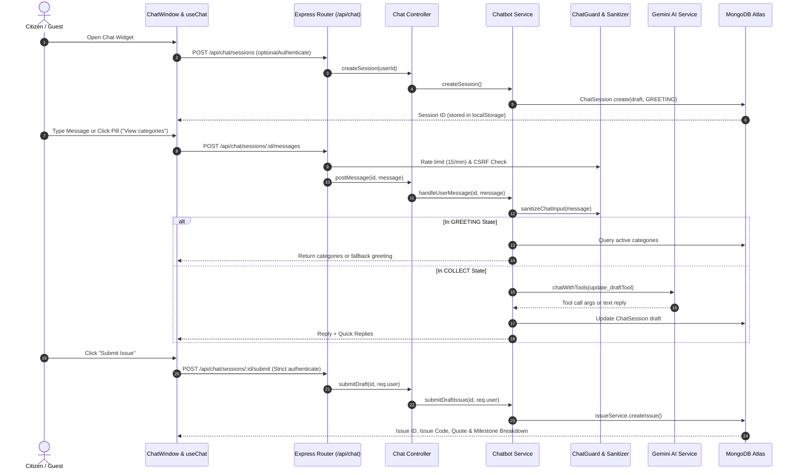

# Comprehensive Audit Report: Crowd Report AI Chatbot

**Branch:** `chatbot-audit-fix`  
**Date:** November 2026  
**Auditor:** Senior Full-Stack Engineer & QA Lead  
**Scope:** Client (`src/components/chatbot/*`, `hooks/useChat.ts`, `services/chat.service.ts`), Server (`routes/chat.routes.js`, `controllers/chat.controller.js`, `services/chatbotService.js`, `services/aiService.js`, `services/chatTools.js`, `utils/chatGuard.js`, `models/ChatSession.js`), Database, Security, WCAG Accessibility, and Performance.

---

## 1. Executive Summary & Top Issues Matrix

The AI Chatbot system on the Crowd Report Platform was designed with a dual architecture: an LLM-assisted conversational pipeline via Gemini API paired with a deterministic state machine fallback. However, our comprehensive audit revealed critical architectural traps, state machine deadlocks, complete absence of project knowledge, IDOR vulnerabilities, and UI token inconsistencies.

### Top Issues Matrix

| Issue ID | Severity | Area | Title | Effort |
|---|---|---|---|---|
| **ISSUE-01** | **P0** | Server / State Machine | "View Categories" Trapped in `COLLECT` State & Fails to Display | **S** |
| **ISSUE-02** | **P0** | Server / Knowledge Base | Chatbot Cannot Answer Website Questions (Job #1 Broken, 0/15 Passed) | **M** |
| **ISSUE-03** | **P0** | Server / Bug | Hardcoded Category Slugs Prevent Issue Submission (`400 Bad Request`) | **S** |
| **ISSUE-04** | **P0** | Server / Security | Session Endpoints Lack Ownership Authorization (IDOR on Chat Sessions) | **S** |
| **ISSUE-05** | **P1** | Server / Data Integrity | Chatbot Auto-Generates Fake Dummy Location & Phone Data on Submission | **S** |
| **ISSUE-06** | **P1** | Server / Categories | Category Listing Omits Descriptions, Base Fees & Turnaround Time | **S** |
| **ISSUE-07** | **P1** | Client / UX & Auth | Guest Issue Filing Reaches Dead-End Without Direct Login / Sign-In Modal | **M** |
| **ISSUE-08** | **P2** | Server / Rate Limiter | Overly Aggressive 15 req/min IP Rate Limiter Triggers 429 on Legitimate Usage | **S** |
| **ISSUE-09** | **P2** | Client / Design Tokens | Hardcoded Colors (`#071329`, `#1E293B`, `#E2E8F0`) Violate Design Tokens | **S** |
| **ISSUE-10** | **P2** | Client / A11y & Mobile | Missing Dialog Focus Trap, Form Labels, and 360px Mobile Keyboard Padding | **M** |

---

## 2. System Mapping & Architecture



### Component Details
1. **Frontend Architecture:**
   - **`ChatWidget.tsx`:** Floating circular launcher (`fixed bottom-6 right-6 z-50`). Shows notification badge with Lucide `Sparkles` and `MessageSquareText`.
   - **`ChatWindow.tsx`:** Slide-up modal (`w-[calc(100vw-2rem)] sm:w-[390px] h-[560px]`). Manages quick replies, location picker trigger, photo file input, and error banners.
   - **`MessageBubble.tsx`:** Lightweight Markdown parser for headings, bullet points, and bold text.
   - **`QuickReplies.tsx`:** Horizontal scroll / flex-wrap pill buttons for interactive selections.
   - **`ChatLocationPicker.tsx`:** Modal hosting `MapPicker` allowing drag-and-drop pin coordinates `[lng, lat]` and address fields.
   - **`useChat.ts`:** Custom React hook. Caches session ID in `localStorage` under `crowd_report_chat_session_id`.
   - **`chat.service.ts`:** Axios API wrapper with TypeScript interfaces (`ChatSession`, `ChatMessage`, `ChatDraft`).

2. **Backend Architecture:**
   - **`chat.routes.js`:** Rate-limited by `chatLimiter` (15 req/min). Uses double-submit CSRF cookie protection.
   - **`chat.controller.js`:** Express request handlers delegating to `chatbotService`.
   - **`chatbotService.js`:** Finite State Machine with states: `GREETING`, `COLLECT`, `CONFIRM`, `SUBMITTED`, `HANDOFF`.
   - **`aiService.js`:** Integrates with Gemini 1.5 Flash via REST endpoint with function declarations (`updateDraftToolDeclaration`).
   - **`chatGuard.js`:** Regex-based sanitization for PII (phone, email, credit cards, Aadhaar) and prompt injection guards.
   - **`ChatSession.js`:** Mongoose model with automatic 24-hour TTL index (`expiresAt: { expireAfterSeconds: 0 }`).

---

## 3. Root Cause Analysis: "View Categories" Bug

### The Problem
When users click the "View categories" quick reply or send "categories", the chatbot frequently fails to show the categories, instead asking *"Which civic service category does this issue relate to?"*.

### Investigation & Root Causes

#### 1. Primary Cause: State Machine Intent Trap
In `server/src/services/chatbotService.js`, the check for categories is located **strictly** within `case 'GREETING'`:
```javascript
// server/src/services/chatbotService.js (Lines 176-180)
case 'GREETING': {
  ...
  else if (textLower.includes('view categories') || textLower.includes('categories')) {
    replyText = `Here are our supported civic service categories:\n\n${categoryList}\n\nSelect a category...`;
    quickReplies = categoryNames.slice(0, 4);
  }
}
```
If a user previously started reporting an issue or typed any message containing "issue" or "report", the session immediately transitioned to `state: 'COLLECT'`.
Once inside `case 'COLLECT'`, the state machine **does not have any check** for "view categories". Instead, it treats the string "View categories" as either:
- An AI input to extract as the issue's `title` or `description`, or
- Falls through to line 290:
```javascript
replyText = 'Which civic service category does this issue relate to?';
quickReplies = categoryNames.slice(0, 4);
```
The user is caught in an inescapable loop where clicking "View Categories" just echoes back the question without listing the categories.

#### 2. Secondary Cause: Database Dependency & Missing Fallback
In `chatbotService.js` (line 132):
```javascript
const activeCategories = await Category.find({ isActive: true }).select('name slug baseFeePaise');
```
If the database collection is empty or unseeded, `activeCategories` is `[]`. Unlike `client/src/services/category.service.ts` which has a static array fallback (`DEFAULT_CATEGORIES`), the chatbot backend has **no fallback**. If unseeded, `categoryList` is an empty string!

#### 3. Tertiary Cause: Incomplete Metadata Projection
In `chatbotService.js`, the category listing code formats the list as:
```javascript
const categoryList = activeCategories.map((c) => `• **${c.name}**`).join('\n');
```
This fails Job #2 specifications:
- **No description** of what each category covers.
- **No base fee** displayed (even though `baseFeePaise` is selected).
- **No resolution turnaround time** (`estimatedResolutionHours`) included.

#### 4. Quaternary Cause: Hardcoded Slug Mismatch
In `chatbotService.js` (lines 142–145):
```javascript
(c.slug === 'pothole-repair' && (s.includes('pothole') || s.includes('road'))) ||
(c.slug === 'streetlight-maintenance' && (s.includes('light') || s.includes('lamp'))) ||
(c.slug === 'waste-management' && (s.includes('garbage') || s.includes('waste'))) ||
(c.slug === 'water-leakage' && (s.includes('water') || s.includes('pipe')))
```
In real database instances, slugs are generated dynamically (e.g. `pothole-repair-1793599324147`) or seeded as `road-damage`, `streetlight-electricity`, `garbage`, `water-supply`. Strict equality `c.slug === 'pothole-repair'` evaluates to `false`, causing category resolution to fail completely!

---

## 4. Detailed Findings by Area

### A. Job #1: Website Knowledge Base (Deficient)
- **Current State:** The server has **no knowledge base** module (`chatKnowledge.js`).
- **Failure Mode:** When users ask questions such as *"what is Crowd Report"*, *"how does payment work"*, *"who are resolvers"*, or *"what is the 50% advance payment"*, the chatbot has no canned or structured domain data.
- **Keyword Hijacking:** If any question contains words like "report" or "issue" (e.g. *"how do I track my reported issue"* or *"what is Crowd Report"*), the state machine erroneously triggers `session.state = 'COLLECT'` and starts drafting an issue report instead of answering the query!
- **Rule-Based Fallback Requirement:** The architecture dictates the chatbot must work **without AI**. Without a comprehensive deterministic knowledge base, the chatbot is completely useless for information retrieval when AI is inactive or quota is reached.

### B. Job #2: Categories & Metadata Quality
- The chatbot needs to display the 4–8 canonical civic categories with descriptions, base fees in rupees (`₹${baseFeePaise / 100}`), and turnaround hours (e.g. `24-48 hrs`).
- When user clicks a category pill (e.g. "Road Damage & Potholes"), the chatbot should instantly record that category in `draft.category` and acknowledge with fee details before proceeding to the location step.

### C. Job #3: Issue Reporting, Auth Security & Dummy Data Injection
1. **Insecure Session Access (IDOR Vulnerability - P0):**
   - Routes `/api/chat/sessions/:id` and `/api/chat/sessions/:id/messages` only use `optionalAuthenticate`.
   - Neither the controller nor the service validates whether `session.user` matches `req.user._id`.
   - Any guest or authenticated user can read or inject messages into another citizen's chat session if they possess the 24-character session ID.
2. **Silent Injection of Fake Dummy Data (P1):**
   - In `chatbotService.js` (lines 474–486), when submitting an issue, if the user has not provided coordinates, address, or phone, the server automatically injects fake dummy data:
     - Coordinates: `[77.2090, 28.6139]` (central Delhi coordinates).
     - Address: `'Civic Location', 'Municipal District', '110001'`.
     - Contact Number: `'9876543210'`.
   - This violates civic platform principles. The chatbot must ask the citizen for their location and contact number before allowing submission.
3. **Guest Submission Dead-End (P1):**
   - In `ChatWindow.tsx`, guest users can fill out the entire issue draft. When they reach the final step and click "Submit Issue", the client receives `401 Unauthorized`.
   - The UI displays a static error string rather than rendering an interactive prompt: *"Please sign in or register to submit your report. Your draft will be saved."* with a direct "Sign In" button.

### D. Validation & Rate Limiting
1. **IP Rate Limit Bottleneck:**
   - `chatLimiter` in `rateLimiters.js` caps chat requests at 15 requests per minute per IP.
   - Because creating a session, sending messages, uploading photos, and requesting categories all share this limiter, a citizen actively conversing with the bot hits `HTTP 429` in under 60 seconds!
   - Recommended fix: Increase `chatLimiter` to 45–60 requests per minute, or key per-session with a generous IP burst allowance.
2. **Input Validation:**
   - Input length is capped at 500 characters via `postMessageSchema`.
   - PII scrubbing in `chatGuard.js` successfully redacts phone numbers, emails, credit cards, and Aadhaar numbers.

### E. UI/UX, Design Tokens & Accessibility
1. **Hardcoded Legacy Colors:**
   - `ChatWidget.tsx` and `ChatWindow.tsx` contain non-token color references:
     - Header gradient: `from-[#071329] via-primary to-primary-hover`
     - Text colors: `text-[#1E293B]` in `MessageBubble.tsx`
     - Borders: `border-[#E2E8F0]/80` in `ChatWindow.tsx`
   - These should be unified to use CSS custom properties defined in `tokens.css`:
     - `--color-primary` (`#0A1F44`)
     - `--color-accent` (`#E8A33D`)
     - `--color-card-border` (`#E2E8F0`)
     - `--color-ink` (`#0F172A`)
2. **Accessibility (WCAG 2.1 AA):**
   - **Dialog Trap:** `ChatWindow` does not trap keyboard focus when open; Tab key cycles through background elements.
   - **Aria Labels:** Input field `<input placeholder="Type your message...">` lacks `aria-label="Chat message"`.
   - **Send & Attachment Buttons:** File upload and map pin buttons lack explicit `aria-label` attributes.
   - **Live Region:** Message container uses `aria-live="polite"`, which is good, but screen reader announcements on loading states are silent.
3. **Mobile Responsiveness (360px Viewport):**
   - At 360px viewport width, `w-[calc(100vw-2rem)]` renders at 328px.
   - When the virtual keyboard appears on mobile devices, `h-[560px] max-h-[85vh]` causes the input area to be clipped below the viewport. Adding `max-h-[100dvh]` or dynamic viewport height on mobile resolves this.

---

## 5. Needs Approval (Proposed Changes)

Before implementing, the following architectural and database adjustments are proposed:

1. **Website Knowledge Base (`server/src/utils/chatKnowledge.js`):**
   - Introduce a structured, grounded knowledge dictionary containing factual data for:
     - Crowd Report platform mission & civic escrow model
     - 50% advance / 50% balance milestone payments
     - Resolver vetting, contractor licensing, and verification
     - Supported states (Pan-India 36 states & UTs)
     - Issue tracking via unique 8-character issue codes
     - Inspection procedures and fee breakdown (platform fee + base fee)
   - *Requires no schema change; purely server logic.*

2. **Session Security & Authorization Check:**
   - In `chat.controller.js`, when a session is associated with an authenticated `user` ID, restrict `getSession`, `postMessage`, `attachImage`, and `submitDraft` so that only the owning user (or an Admin) can access it.
   - For guest sessions (`user === null`), allow access by session ID, but when the user logs in, link the session to their account.
   - *Requires no schema change.*

3. **Fallback Categories Data in Service:**
   - If `Category.find({ isActive: true })` returns fewer than 3 items (unseeded DB), automatically merge or fallback to canonical categories (`road-damage`, `streetlight-electricity`, `garbage`, `water-supply`, etc.) with real base fees and turnaround times.
   - *Requires no schema change.*

4. **Eliminate Fake Dummy Data Injection:**
   - Require real location and phone collection in `COLLECT` state before transitioning to `CONFIRM` or `SUBMITTED`.
   - *Ensures data integrity.*

5. **Adjust `chatLimiter`:**
   - Increase rate limiter from 15 req/min to 60 req/min to allow normal human chat velocity without 429 errors.

---

## 6. Proposed Fix Order (Phased Implementation Plan)

Once user types `Implement` (or specific issue numbers), fixes will be rolled out in atomic commits:

### Phase A: Critical Server Fixes (P0)
- **C1: Category Bug & State Machine Decoupling (`ISSUE-01`, `ISSUE-03`):**
  - Make "View categories" / "categories" an omnipresent intent across ALL states (`GREETING`, `COLLECT`, `CONFIRM`).
  - Fix fuzzy category matching using regex / startsWith to handle dynamic slugs (`pothole-repair-1793599324147`).
  - Enrich category output with descriptions, fees in ₹, and response times (`ISSUE-06`).
- **C2: Factual Website Knowledge Base (`ISSUE-02`):**
  - Implement `chatKnowledge.js` covering the 15 website questions.
  - Implement intent router that answers questions without entering `COLLECT` state when questions contain words like "report" or "issue".
  - Integrate knowledge into Gemini prompt when AI is available, and deterministic matching when AI is disabled.
- **C3: Session Security & Ownership Authorization (`ISSUE-04`):**
  - Enforce session ownership verification in `chat.controller.js`.

### Phase B: Reporting Integrity & Guest UX (P1)
- **C4: Required Data Collection & Anti-Dummy Data (`ISSUE-05`):**
  - Guide users through title -> category -> location -> contact before confirming.
  - Remove silent dummy fallbacks (`'Civic Location'`, `'9876543210'`).
- **C5: Guest Submission Graceful Auth Handoff (`ISSUE-07`):**
  - In `ChatWindow.tsx`, display an interactive login / register card when a guest completes a draft, preserving the session ID so it is submitted upon login.

### Phase C: Polish, Performance & Design Tokens (P2)
- **C6: Rate Limiting & Token Normalization (`ISSUE-08`, `ISSUE-09`):**
  - Increase `chatLimiter` to 60 req/min.
  - Replace hardcoded `#071329`, `#1E293B`, `#E2E8F0` with CSS variables `--color-primary`, `--color-ink`, `--color-card-border`.
- **C7: A11y & Mobile Responsiveness (`ISSUE-10`):**
  - Add missing ARIA labels, focus trap on dialog open, and mobile viewport height handling.

